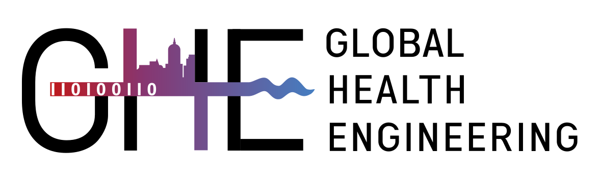
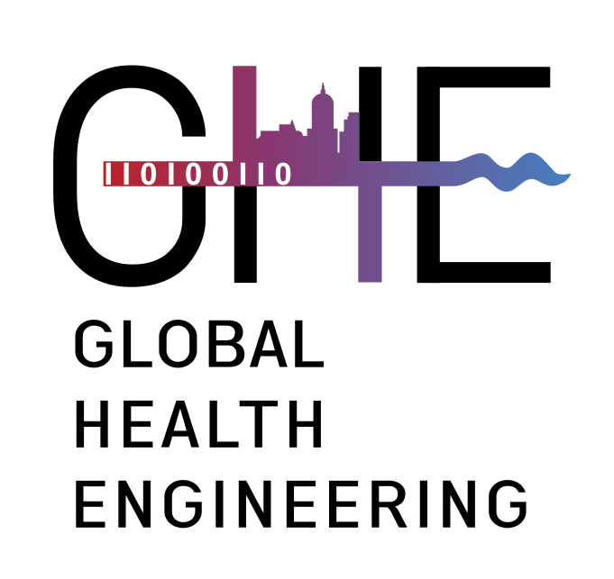

```{r setup}
library(ggplot2)
library(gt)
brand <- yaml::read_yaml("_brand.yml")
pal <- brand$color$palette
# Drop the Bootstrap aliases (their value is the name of another token).
pal <- pal[grepl("^#", unlist(pal))]
hex <- function(name) pal[[name]]
lum <- function(h) {
  v <- grDevices::col2rgb(h)[, 1] / 255
  f <- function(c) ifelse(c <= 0.03928, c / 12.92, ((c + 0.055) / 1.055)^2.4)
  sum(c(0.2126, 0.7152, 0.0722) * f(v))
}
ratio <- function(a, b) {
  la <- lum(a); lb <- lum(b)
  round((max(la, lb) + 0.05) / (min(la, lb) + 0.05), 2)
}
verdict <- function(r) ifelse(r >= 7, "AAA", ifelse(r >= 4.5, "AA", ifelse(r >= 3, "large text only", "fail")))
chart <- unlist(pal[paste0("chart-", 1:6)], use.names = FALSE)
```

Everything on this page, the swatches, the contrast table and the charts, is computed from `_brand.yml` at render time.

## Typography

Body text runs in Atkinson Hyperlegible Next. Headings use its bold weight in the primary colour. Here is a [link in the brand indigo](https://ghe.ethz.ch), some **bold text**, some *italic text*, and inline code like `read_csv("data.csv")` in Source Code Pro on the light indigo tint.

```r
# Code blocks use Source Code Pro on the same tint.
library(ghedata)
```

## The palette

```{r palette}
#| fig-width: 9
#| fig-height: 5
#| fig-alt: "One tile per colour of the palette with its token name and hex value."
d <- data.frame(name = names(pal), hex = unlist(pal, use.names = FALSE))
d$i <- seq_len(nrow(d)) - 1
d$col <- d$i %% 7
d$row <- -(d$i %/% 7)
d$text <- ifelse(vapply(d$hex, ratio, numeric(1), b = "#ffffff") >= 4.5, "#ffffff", hex("ink"))
ggplot(d, aes(col, row)) +
  geom_tile(aes(fill = hex), width = 0.94, height = 0.9, colour = hex("ghe-gray-light")) +
  geom_text(aes(label = paste0(name, "\n", hex), colour = text), size = 2.8, lineheight = 1) +
  scale_fill_identity() +
  scale_colour_identity() +
  theme_void() +
  theme(plot.background = element_rect(fill = hex("paper"), colour = NA))
```

## Contrast

Contrast of each colour as text on paper and on white, and of white text on the colour (WCAG 2). Body text needs 4.5:1; large text and chart marks need 3:1.

```{r contrast}
ct <- data.frame(
  token = names(pal),
  hex = unlist(pal, use.names = FALSE)
)
ct$on_paper <- vapply(ct$hex, ratio, numeric(1), b = hex("paper"))
ct$on_white <- vapply(ct$hex, ratio, numeric(1), b = "#ffffff")
ct$as_text <- verdict(ct$on_paper)
ct <- ct[!ct$token %in% c("paper", "white"), ]
gt(ct) |>
  cols_label(
    token = "Token", hex = "Value", on_paper = "On paper",
    on_white = "On white", as_text = "As text on paper"
  ) |>
  tab_options(table.background.color = hex("paper"))
```

## Charts

The six chart colours in their order, all from the palette. Take them from the first on and never cycle them. A chart with one highlighted series uses `chart-2`, the orange, for it and `ink` or `ghe-gray` for the rest. The orange is for filled marks; a thin line in orange is hard to see on a light background.

```{r chart-bars}
#| fig-width: 8
#| fig-height: 4
#| fig-alt: "Bar chart with six bars, one in each chart colour."
theme_ghe <- theme_minimal(base_size = 13) +
  theme(
    plot.background = element_rect(fill = hex("paper"), colour = NA),
    panel.grid.minor = element_blank(),
    panel.grid.major.x = element_blank(),
    text = element_text(colour = hex("ink")),
    plot.title = element_text(face = "bold", colour = hex("ghe-indigo"))
  )
bars <- data.frame(series = paste0("chart-", 1:6), value = c(97, 85, 67, 47, 20, 15))
ggplot(bars, aes(series, value, fill = series)) +
  geom_col(width = 0.7) +
  scale_fill_manual(values = setNames(chart, bars$series), guide = "none") +
  labs(title = "Categorical series", x = NULL, y = NULL) +
  theme_ghe
```

```{r chart-lines}
#| fig-width: 8
#| fig-height: 4
#| fig-alt: "Line chart with three series in indigo, orange and teal."
set.seed(1)
lines <- expand.grid(month = 1:24, series = c("Bachelor", "Master", "Doctorate"))
lines$value <- ave(rnorm(nrow(lines), 1, 2), lines$series, FUN = cumsum) + 20
ggplot(lines, aes(month, value, colour = series)) +
  geom_line(linewidth = 1.2) +
  scale_colour_manual(values = chart[1:3]) +
  labs(title = "Three series: indigo, orange, teal", x = NULL, y = NULL, colour = NULL) +
  theme_ghe +
  theme(legend.position = "top")
```

```{r chart-seq}
#| fig-width: 8
#| fig-height: 1.6
#| fig-alt: "Sequential ramp from light indigo to dark indigo in nine steps."
ramp <- data.frame(x = 1:9)
ggplot(ramp, aes(x, 1, fill = x)) +
  geom_tile(colour = hex("paper"), linewidth = 1) +
  scale_fill_gradient(low = hex("seq-low"), high = hex("seq-high"), guide = "none") +
  labs(title = "Sequential ramp") +
  theme_void(base_size = 13) +
  theme(
    plot.background = element_rect(fill = hex("paper"), colour = NA),
    plot.title = element_text(face = "bold", colour = hex("ghe-indigo"))
  )
```

## Logo

::: {layout-ncol=3}





:::

The files come from the corporate design folder of the group drive. The icon also exists in white for dark backgrounds.

## Open in this draft

- Which colour leads. The draft takes `ghe-indigo` for headings and links, because it is the darkest of the primary range. The group website uses a blue (`#0F4C81`) that is not in the palette.
- The shades of indigo, the gray and the sequential ramp are new and are not in the palette.
- Typography. The PowerPoint template of the group uses Calibri; the draft takes Atkinson Hyperlegible Next as the website does.
- No dark mode file yet (`_brand-dark.yml` in openwashdata/brand).
- No Quarto extension for PDF and Word, no avatar and no social preview image yet.
